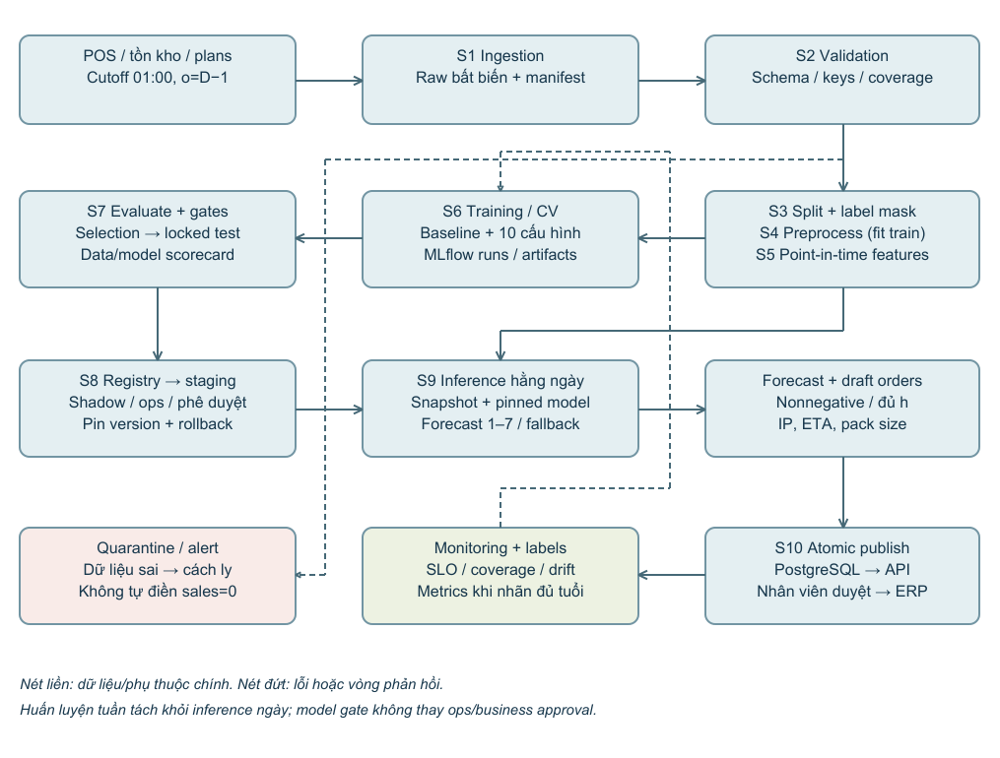
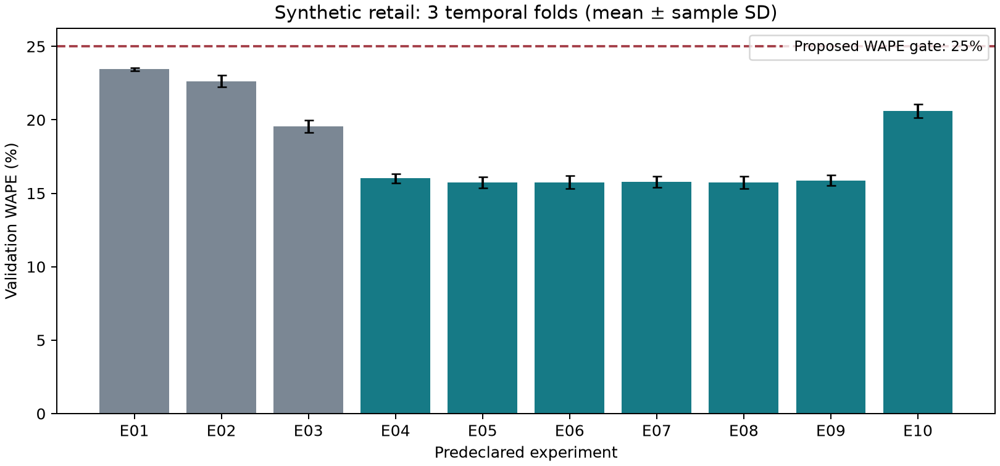
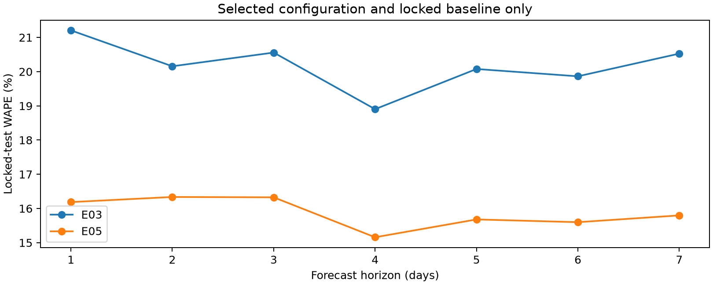
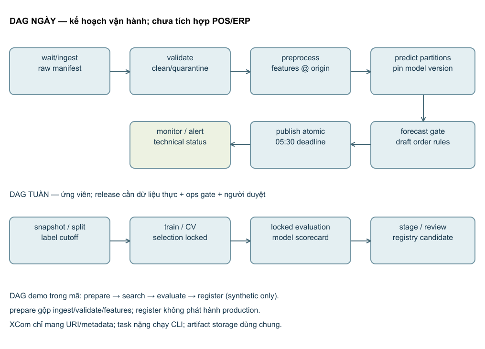

# THIẾT KẾ ML PIPELINE VÀ PHÂN TÍCH MLOPS
## Dự báo nhu cầu hàng hóa hằng ngày cho chuỗi bán lẻ

Học phần: DDM501 — AI in DevOps, DataOps, MLOps

Bài tập cá nhân 2 — ML Pipeline Design & MLOps Analysis

Sinh viên: Nguyễn Minh Trường · Mã số: 25MS13312

Ngày báo cáo: 03/10/2026 · Phiên bản: 1.1 — đã rà soát và rút gọn mã minh họa

Báo cáo tiếp nối Assignment 1; thực nghiệm minh họa trên dữ liệu mô phỏng

---

# Tóm tắt

Báo cáo phát triển thiết kế hệ thống dự báo nhu cầu bán lẻ trong Assignment 1 thành một pipeline có hợp đồng dữ liệu, điểm kiểm soát chất lượng, theo dõi thí nghiệm và điều phối công việc. Hệ thống đích phục vụ 20 cửa hàng với khoảng 2.000 sản phẩm/cửa hàng, tạo dự báo bảy ngày bằng một mô hình dùng chung. Dự báo được chuyển thành đơn nháp theo chính sách tồn kho và được nhân viên duyệt trước khi gửi ERP. Thiết kế giữ nguyên yêu cầu công bố trước 05:30, đánh giá theo thời gian và kiểm soát nhãn bị giới hạn do hết hàng.

Đóng góp chính là kết nối các quyết định dữ liệu, mô hình và vận hành bằng bằng chứng có thể truy vết. Mười cấu hình được thực thi trên dữ liệu mô phỏng với ba cửa sổ xác thực tiến dần; chỉ một cấu hình đã khóa được đánh giá trên tập kiểm tra cuối cùng, cùng phương pháp cơ sở đã chọn trước. Các runs và model version được ghi thực tế bằng MLflow. Kết quả định lượng và cấu hình đề xuất được trình bày ở phần 2, kèm phân tích sai số, trade-off và giới hạn ngoại suy.

Phần pipeline, Airflow và phát hành mô tả kiến trúc vận hành đề xuất. Mã huấn luyện, kiểm tra hợp đồng, logging và registry đã chạy cục bộ; DAG được kiểm tra cú pháp nhưng chưa chạy trong Airflow. Container, PostgreSQL, ERP, kiểm thử tải và thử nghiệm kinh doanh chưa triển khai. Dữ liệu mô phỏng không chứng minh hệ thống đạt mục tiêu giảm hết hàng hoặc giảm tồn kho ở doanh nghiệp.

## Phân biệt yêu cầu, giả định và bằng chứng

| Loại thông tin | Nguồn và trạng thái |
| --- | --- |
| Yêu cầu bài tập | PDF Assignment 2: năm phần với tỷ trọng 25%/25%/20%/20%/10%; tối thiểu 8–10 cấu hình; MLflow, Airflow, configuration và Dockerfile; báo cáo PDF đúng tên. |
| Ràng buộc hệ thống | Assignment 1 của Nguyễn Minh Trường [A1]: hệ thống bán lẻ giả định; quy mô, SLO và ngưỡng nghiệm thu là giả định thiết kế. |
| Bằng chứng đo được | Thực nghiệm mô phỏng do mã nguồn đi kèm sinh và đánh giá; bảng số liệu lấy từ CSV/JSON, không điền thủ công để tạo thành tích. |
| Nội dung chưa đo | Hiệu quả tại doanh nghiệp, nhu cầu mất khi hết hàng, chi phí hạ tầng, tải MVP và độ tin cậy dịch vụ. |

---

# 0. Kế thừa và tinh chỉnh Assignment 1

## 0.1 Bài toán và kiến trúc trước

Assignment 1 [A1], các mục 1.7, 2.3, 3.3 và 4.5, xác lập một mô hình dự báo dùng chung, lịch xử lý lô hằng ngày, mô hình LightGBM ứng viên trên CPU, MLflow, kho nguồn bất biến, PostgreSQL và API đọc kết quả. Quy ước ngày gốc o là ngày bán hàng hoàn chỉnh cuối cùng; lần chạy sáng ngày D dùng lịch sử đến D−1, nên o=D−1 và h=1 tương ứng ngày D. Hệ thống tạo 280.000 dòng dự báo/ngày ở quy mô 40.000 cặp cửa hàng–SKU. Mục tiêu nghiệp vụ là giảm hết hàng và tồn kho dư; chất lượng dự báo chỉ là điều kiện trung gian.

Mục tiêu mô hình kế thừa: WAPE không quá 25%, cải thiện tương đối ít nhất 10% so với cơ sở tốt nhất, độ chệch tuyệt đối không quá 5%, và WAPE nhóm quan trọng không xấu hơn cơ sở quá 2 điểm phần trăm. Các ngưỡng này không phải chuẩn phổ quát. Chúng phải được chủ nghiệp vụ xác nhận và kiểm chứng bằng dữ liệu thực trước phát hành.

## 0.2 Những tinh chỉnh có lý do

| Hạng mục | Kế thừa | Cụ thể hóa ở Assignment 2 |
| --- | --- | --- |
| Dữ liệu và đặc trưng | Nguồn bất biến, feature đúng thời điểm, loại nhãn hết hàng | Manifest SHA-256; kiểm tra schema/key/domain; mặt nạ nhãn; test sửa dữ liệu tương lai; kiểm tra thời điểm công bố kế hoạch. |
| Chọn mô hình | LightGBM Poisson là ứng viên, phải so sánh cơ sở | Ma trận 10 cấu hình, Ridge và phép loại khuyến mãi; không mặc định LightGBM thắng; số cây cố định để tránh early stopping trên test. |
| Đánh giá | Train tháng 1–12; xác thực tháng 13–15; test tháng 16–18 | Purge theo ngày đích nhãn; lấy ngày gốc cách bảy ngày trong demo để không đếm cùng ngày đích nhiều lần; báo cáo hạn chế weekday coverage. |
| Điều phối | Lịch ngày và retrain tuần | Phân biệt DAG suy luận ngày, DAG ứng viên tuần và DAG demo đã viết; dữ liệu lớn đi qua artifact URI. |
| Phát hành | Có người duyệt, pin version, rollback | Cổng dữ liệu/mô hình/vận hành độc lập; registry demo bị gắn deployment_allowed=false; không gán champion từ bằng chứng mô phỏng. |

## 0.3 Câu hỏi và giả thuyết

Q1: đặc trưng biết trước của khuyến mãi có giảm sai số ngoài mẫu so với cơ sở mùa vụ đã hiệu chỉnh hay không? Q2: tăng độ phức tạp của cây hoặc đổi hàm mất mát có mang lại cải thiện đáng kể về mặt thực tiễn mà không vi phạm độ chệch và nhóm? Q3: có thể truy vết và chạy lại cùng pipeline mà không làm sai thời điểm dữ liệu hay thay đổi kết quả đã công bố không?

H1 kế thừa là cải thiện WAPE tương đối ít nhất 10% so với cơ sở tốt nhất, đồng thời đạt các cổng khác. Phép so sánh E05/E10 kiểm tra đóng góp nhóm khuyến mãi; E05/E06/E07 kiểm tra số lá; E05/E08 kiểm tra tốc độ học; E05/E09 kiểm tra hàm mục tiêu. Các đối chiếu này mô tả ảnh hưởng cấu hình trong protocol đã cho, không suy ra quan hệ nhân quả kinh doanh.

---

# 1. Thiết kế pipeline (25%)

## 1.1 Sơ đồ kiến trúc và luồng dữ liệu



Sơ đồ phân biệt đường huấn luyện ứng viên và đường suy luận hằng ngày. Dữ liệu nguồn được lưu bất biến; validation tạo dữ liệu chuẩn hóa hoặc vùng cách ly; preprocessing và feature engineering tạo ảnh chụp có phiên bản. Training đọc các split hợp lệ, evaluation tạo quyết định, registry lưu phiên bản. Đường suy luận đọc phiên bản đã được duyệt và ảnh chụp của ngày gốc, thay vì huấn luyện lại trước mỗi lần xuất dự báo.

Ngày hết hàng ở ngày đích chỉ dùng để chọn nhãn khi đã biết kết quả; không trở thành feature tương lai. Khuyến mãi và giá dự kiến được join theo phiên bản kế hoạch có published_at không muộn hơn cutoff. Khi nguồn có sửa hồi tố, giữ cả event time và thời điểm nhận dữ liệu; backtest phải dùng phiên bản từng thực sự sẵn có, không chỉ bản cuối đã chỉnh sửa.

## 1.2 Đặc tả các stage và điểm chặn chất lượng

| Stage | Mục đích; input → output | Operations và quality gate |
| --- | --- | --- |
| S1 Ingestion | Đọc POS, tồn kho, danh mục và kế hoạch → raw snapshot + manifest | Incremental extract theo watermark; kiểm tra nguồn, checksum và thời điểm chốt. Đối soát POS lệch ≤0,1%; nguồn đến trước 01:00; lỗi tạm thời retry có giới hạn. |
| S2 Validation | Snapshot → clean partition, validation report, quarantine | Kiểm tra schema, kiểu, khóa duy nhất store/SKU/date, FK, số không âm/hữu hạn và lịch ngày. Kế thừa coverage khóa ≥99%, dòng hợp lệ ≥99,5%. Không coi tệp thiếu là lượng bán bằng 0. |
| S3 Split/label mask | Dữ liệu hợp lệ → split manifest, eligible labels | Gom toàn bộ chuỗi theo ngày gốc; bảo đảm mọi target_date train < origin đầu validation/test. Loại nhãn ngày đích hết hàng; ghi số dòng loại và độ bao phủ. |
| S4 Preprocessing | Train split và các split đánh giá → transformer đã fit + ma trận | Median imputation trên train cho feature thiếu; one-hot IDs/lịch; scaling cho Ridge. Fit riêng từng fold; không fit bằng test. Schema và thứ tự feature là hợp đồng. |
| S5 Feature engineering | Lịch sử đến o, plan hợp lệ, h → feature snapshot | Lag 1/7/14/28, rolling 7/28, cùng thứ bốn tuần, availability quá khứ, lịch ngày đích, khuyến mãi/giá đã biết. Kiểm tra point-in-time và lịch sử ít nhất 56 ngày. |
| S6 Training | Snapshot + config + seed → model, metrics, artifacts | Ba expanding folds; cùng 200 cây và 2 luồng cho các LightGBM. Mỗi fit ghi MLflow run; kiểm tra hữu hạn, hội tụ và ngân sách. |
| S7 Evaluation | Forecast + nhãn đủ điều kiện + baseline → scorecard + quyết định | WAPE, bias, MAE/RMSE, MASE mặt nạ, nhóm/chân trời, coverage và thời gian. Cấu hình khóa trước test; cổng tổng hợp và từng nhóm. |
| S8 Deployment | Model version vượt gate + release manifest → staging/release | Signature/input example; smoke test, shadow; kiểm tra tải; người duyệt. Pin registry version; lưu prior version để rollback. Demo không qua cổng triển khai thực. |
| S9 Batch prediction | Snapshot ngày D + model đã pin → forecast partitions | Dự báo 1–7; kiểm tra đủ khóa/horizon, duy nhất, hữu hạn, không âm. Thiếu cặp chuyển fallback có nhãn; thiếu tồn kho quan trọng chặn xuất đơn. |
| S10 Publish/monitor | Forecast + IP + policy → published run, draft orders, telemetry | Kiểm tra pack size, ETA và approval; publish nguyên tử; ERP idempotency key. Theo dõi deadline, coverage, drift và chất lượng khi nhãn đến. |

Ngưỡng production trong bảng là yêu cầu kế thừa. Demo không có POS thực, khóa ngoại ERP hoặc snapshot tồn kho nên chỉ thực thi các gate schema/key/domain, thời điểm feature, split, metrics và registry. Không gộp những kiểm tra chưa chạy vào kết quả nghiệm thu.

## 1.3 Hợp đồng dữ liệu và biến đổi

Khóa nguồn là store_id/sku_id/date. Khóa forecast là store_id/sku_id/forecast_origin/horizon_days/model_version. Forecast lưu target_date, predicted_units, run_id, data_cutoff và quality_status. Manifest mô tả schema_version, data URI/hash, feature_version, config hash và split boundaries. Mỗi stage phải kiểm tra phiên bản hợp đồng trước khi sử dụng artifact của stage trước.

Feature lag_1 ở lần chạy D dùng y(D−1)=y(o); lag_7 dùng y(D−7)=y(o−6). Feature rolling kết thúc tại o. Với h=1…7, lịch ngày đích o+h được biết; sales ngày đích không được biết. Cùng thứ bốn tuần dùng y(o+h−7k), k=1…4; tất cả chỉ số này không vượt o. Lượng bán ở ngày lịch sử hết hàng được đánh dấu thiếu cho thống kê, kèm available_fraction_28 và origin_available. Imputer chỉ học từ train; mọi nhóm không có đủ lịch sử hợp lệ phải dùng fallback rõ ràng.

Nhu cầu tiềm ẩn không quan sát được khi hết hàng. Trong dữ liệu mô phỏng, latent_demand_audit_only được lưu để kiểm tra quá trình sinh dữ liệu nhưng bị loại khỏi FEATURES và label. Chỉ dùng observed sales của ngày available=1. Điều này mô phỏng chính sách Assignment 1 nhưng vẫn có selection bias; không khẳng định đã giải quyết demand censoring ở thực tế.

## 1.4 Lý do thiết kế, modularity và khả năng mở rộng

Batch phù hợp với xét đơn hằng ngày, giúp dành khoảng phục hồi từ 03:30 đến 05:30. Một mô hình direct multi-horizon dùng chung nhận h và các feature đúng thời điểm; không dùng forecast của h trước làm feature cho h sau nên tránh lan truyền sai số qua chuỗi dự báo. Đánh đổi là phải mở rộng mẫu theo h và kiểm tra cân bằng giữa chân trời, cửa hàng và danh mục.

Các hàm validate_data, build_features, temporal_split, make_model và quality_gate có trách nhiệm riêng, type hints và docstrings. Cùng build_features phục vụ backtest và suy luận với cutoff được kiểm soát. Estimator và preprocessing đóng gói trong Pipeline; fit được thực hiện trong từng split để giảm lỗi leakage [5]. Mô hình và orchestration tách rời: task nhận URI/manifest, còn logic dự báo chạy qua CLI có thể kiểm thử độc lập.

Quy mô 18 tháng của Assignment 1 có khoảng 21,92 triệu dòng nguồn; mở rộng bảy chân trời có thể đạt 153 triệu mẫu. Demo chỉ có 48 chuỗi để minh họa. Với production, dùng Parquet phân vùng ngày/cửa hàng, xử lý feature bằng truy vấn/chunk, lấy mẫu ngày gốc có seed hoặc lưu tensor feature một lần và mở rộng h trong từng partition. Đặt pool cho job huấn luyện, giới hạn OpenMP để tránh mỗi task dùng toàn bộ CPU. Không suy luận tuyến tính thời gian chạy demo thành thời gian 280.000 dòng; phải load test cả I/O, feature và publish.

Không đưa Kafka, feature store riêng hoặc Kubernetes vào MVP chỉ để tăng số công cụ. Xem xét chúng khi nhật ký vận hành cho thấy cần freshness trong ngày, nhiều consumer dùng feature hoặc scheduling/resource isolation vượt khả năng nền tảng hiện có. Đơn giản hóa hạ tầng giảm chi phí nhưng đòi hỏi hợp đồng và lineage rõ để tránh nợ kỹ thuật do phụ thuộc dữ liệu [8].

## 1.5 Lỗi, khôi phục và rollback

| Lỗi | Quyết định và khôi phục | Bằng chứng cần lưu |
| --- | --- | --- |
| Nguồn đến muộn hoặc mất kết nối | Retry I/O theo backoff; cảnh báo tại 02:00; nếu hết ngân sách deadline, forecast fallback có trạng thái. | Watermark, lần retry, freshness và owner. |
| Schema/key/domain sai | Quarantine; fail partition hoặc snapshot; không retry mãi cùng dữ liệu. | Validation report, dòng lỗi, source version. |
| Worker dừng giữa tác vụ | Ghi artifact vào staging prefix; hoàn tất mới commit manifest; rerun partition lỗi. | Run key, checksum, partition complete flags. |
| Model/gate thất bại | Giữ champion cũ hoặc baseline; ứng viên không có quyền production. | Scorecard, điều kiện failed, reviewer decision. |
| Forecast âm/NaN/trùng/thiếu horizon | Chặn publish; tái xử lý partition; fallback nếu hợp đồng cho phép. | Coverage và quality_status của từng cặp. |
| Publish/ERP timeout | Publish bằng transaction; truy vấn ERP theo idempotency key trước retry. | Published run pointer, approval version, request key. |

Retry không mặc nhiên tạo idempotency. Khóa vận hành phải gồm pipeline version, data interval và snapshot/config hash. Thay đổi source hoặc cấu hình tạo run mới, không ghi đè run cũ. MLflow run/version mới khi retry có thể phát sinh trùng metadata; production cần ledger run_key→run_id/version và khóa giao dịch để reuse hoặc đánh dấu superseded. Demo dùng JSON atomic replace cho artifact nhỏ, nhưng chưa triển khai ledger đa worker; giới hạn này được công bố thay vì coi script là hệ thống exactly-once.

Rollback model chỉ thay reference cho các lần chạy mới. Run đã công bố và đơn đã duyệt vẫn pin phiên bản cũ; không âm thầm tính lại đơn nhân viên đã phê duyệt. Khi lỗi source, khôi phục model không sửa được dữ liệu sai; cần rollback snapshot hoặc dùng dự phòng.

---

# 2. Theo dõi thí nghiệm và phân tích metrics (25%)

## 2.1 Dữ liệu thực nghiệm và tính hợp lệ

Thực nghiệm dùng 48 chuỗi (4 cửa hàng × 12 SKU), 26,304 dòng nguồn, từ 2024-01-01 đến 2025-07-01; 23,520 mẫu origin/horizon trước label mask. Seed=501; tỷ lệ ngày available thực sinh là 95.86%. Phạm vi này thu nhỏ hệ thống giả định, không thay đổi quy mô production của Assignment 1.

Generator có mức bán khác nhau theo SKU/cửa hàng, mùa vụ tuần, biến động năm nhẹ, xu hướng và khuyến mãi. Nhu cầu đếm được sinh bằng Gamma–Poisson với shape=80 để có overdispersion; hệ số khuyến mãi theo danh mục là 0,40/0,52/0,64. Xác suất khuyến mãi dự kiến 17%; xác suất thiếu hàng 4%; khi thiếu hàng, lượng bán bị giới hạn qua phép lấy mẫu Binomial với xác suất 0,45. Đây là tham số mô phỏng, không phải số đo tại chuỗi bán lẻ. Kế hoạch giá/khuyến mãi được công bố 14 ngày trước ngày đích.

Mô phỏng kiểm chứng code path và cách so sánh, nhưng thiên về mẫu quan hệ được người thiết kế định nghĩa. Không có lead-time uncertainty, sự kiện lễ Việt Nam, sản phẩm mới, nhà cung cấp lỗi hoặc can thiệp tồn kho thay đổi theo đơn ML. Một seed không thể đại diện toàn bộ môi trường; chưa kiểm tra độ bền nhiều cơ chế sinh dữ liệu. Không chọn seed sau khi xem test để làm đẹp kết quả.

## 2.2 Giao thức thời gian và chống leakage

| Lượt | Vùng ngày gốc đánh giá | Huấn luyện và kiểm soát |
| --- | --- | --- |
| CV1 | Tháng 01/2025, chỉ origin đủ bảy ngày đích trong tháng | Lịch sử 2024; mọi nhãn train trước origin đầu CV1; imputer/encoder/model fit trên train. |
| CV2 | Tháng 02/2025, cùng quy tắc | Expanding train đến trước origin đầu CV2; không tái sử dụng transformer đã fit trên tương lai. |
| CV3 | Tháng 03/2025, cùng quy tắc | Expanding train đến trước origin đầu CV3; chọn cấu hình và baseline bằng validation. |
| Locked test | Tháng 04–06/2025 | Khóa selection.json trước khi đọc kết quả test; refit một cấu hình và một baseline; không sửa hyperparameter theo test. |

Không dùng random train/test split cho bảng đã mở rộng theo horizon. Mọi store/SKU cùng ngày gốc được gán một vùng thời gian. training.target_date.max phải nhỏ hơn evaluation.origin.min; quy tắc loại nhãn chồng lấn được kiểm tra bằng unit test. Thực nghiệm giữ model cố định trong test; cập nhật lịch sử sales thật đã có tại mỗi origin. Đây là đánh giá dự báo với lịch sử mới, không phải dự báo toàn bộ ba tháng từ một origin duy nhất [1].

Ngày gốc demo cách bảy ngày và cùng thứ, tạo ngày đích không chồng lấn trong mỗi fold. Cách này giảm kích thước mẫu và làm rõ paired comparison, nhưng không đại diện đủ bảy weekday của origin. Production phải replay origin hằng ngày, chặn nhãn chồng lấn tại ranh giới và dùng thống kê theo block để không coi dự báo chồng lấn là mẫu độc lập. Ngày cuối tháng không đủ h=7 bị loại cùng cho tất cả phương án; số dòng/coverage được lưu trong artifacts.

## 2.3 Ma trận 10 cấu hình và giả thuyết đối chiếu

| ID | Thuật toán | Cấu hình | Mục tiêu |
| --- | --- | --- | --- |
| E01 | Mean 28 | Trung bình 28 ngày | Baseline chính sách hiện tại |
| E02 | Seasonal 4 tuần | Cùng thứ 4 tuần | Baseline mùa vụ |
| E03 | Seasonal + promo | Hệ số promo học trên train | Baseline mạnh đã hiệu chỉnh |
| E04 | Ridge | alpha=10; full | Đối chiếu mô hình đơn giản |
| E05 | LGBM Poisson | 31 lá; lr=0,05; full | Ứng viên A1 cụ thể hóa |
| E06 | LGBM Poisson | 15 lá; lr=0,05; full | Giảm capacity so E05 |
| E07 | LGBM Poisson | 63 lá; lr=0,05; full | Tăng capacity so E05 |
| E08 | LGBM Poisson | 31 lá; lr=0,10; full | Tăng learning rate so E05 |
| E09 | LGBM L1 | 31 lá; lr=0,05; full | Đổi objective so E05 |
| E10 | LGBM Poisson | 31 lá; lr=0,05; no promo/price | Ablation khuyến mãi so E05 |

Tất cả phương án sử dụng cùng nhãn đủ điều kiện và các origin; baseline không hưởng feature tương lai. E03 là seasonal mean được nhân hệ số khuyến mãi học bằng least squares chỉ trên train; hệ số cho ngày không khuyến mãi giữ bằng 1. E04 sử dụng median imputation, one-hot và StandardScaler, alpha=10. E05–E10 dùng cùng 200 cây, min_child_samples=30, reg_lambda=1, deterministic=true, force_col_wise=true, seed=501 và n_jobs=2. Không early stopping, vì chọn số vòng trên test gây leakage; 200 là ngân sách minh họa đã định trước.

Các LightGBM dùng cùng preprocessing với Ridge để quản lý hợp đồng. Scaling không cần cho cây; giữ trong demo giúp thống nhất code path nhưng tốn thêm chi phí. Khi triển khai có thể bỏ scaling cho cây qua một pipeline khác sau khi xác nhận kết quả tương đương. One-hot ID phù hợp demo nhỏ; với 2.000 SKU cần benchmark encoding categorical native hoặc encoding phù hợp mà không học từ test. E10 bỏ cả promo và planned_price để tránh giá tiết lộ gián tiếp khuyến mãi.

Poisson dùng loss trung bình μ−y·log(μ), μ>0, hướng tới kỳ vọng của lượng đếm; không chứng minh demand thật có variance bằng mean. L1 hướng tới median, phù hợp sai số tuyệt đối nhưng có thể gây lệch tổng nhu cầu khi phân phối bất đối xứng. Các objective và siêu tham số đối chiếu được hỗ trợ bởi LightGBM [6]; lựa chọn cuối vẫn dựa vào protocol và gate của bài toán.

## 2.4 Primary, secondary và liên hệ nghiệp vụ

WAPE (%) = 100 × Σ|y−f| / Σy. Đây là primary kế thừa vì diễn giải được sai số tổng đơn vị. Không lấy trung bình phần trăm từng dòng. Với tổng y=0, WAPE không xác định; báo MAE và flag, không chia bằng epsilon để tạo số hữu hạn giả.

Signed bias (%) = 100 × Σ(f−y) / Σy; dấu dương là dự báo cao. MAE = mean(|y−f|), RMSE = sqrt(mean((y−f)²)). Secondary gồm bias, MAE/RMSE, WAPE h=1…7, cửa hàng/danh mục, coverage và thời gian. Không dùng accuracy, F1 hay ROC-AUC cho bài toán hồi quy nhu cầu.

MASE từng chuỗi = MAE đánh giá / mean(|y(t)−y(t−7)|) trên train. Mẫu số chỉ dùng cặp ngày available=1 ở cả hai đầu; báo đây là MASE điều chỉnh mặt nạ, khác cách tính chuẩn khi không có missing. Báo macro-average qua chuỗi, số chuỗi hợp lệ/bị loại; mẫu số 0 hoặc thiếu cặp thì dùng MAE cho chuỗi đó. Ý tưởng scaled error dựa trên [2]; quy tắc mặt nạ là quyết định của bài này.

| Chỉ số | Quyết định hỗ trợ | Giới hạn |
| --- | --- | --- |
| WAPE | Đánh giá forecast tổng đơn vị; so sánh baseline và cấu hình | Có thể che SKU lượng bán thấp; không chuyển trực tiếp thành tỷ lệ hết hàng. |
| Bias | Nhận diện xu hướng đặt dư/thiếu khi cộng demand | Tổng bias gần 0 vẫn có thể triệt tiêu lệch giữa nhóm. |
| MASE, slices | Bảo vệ chuỗi nhỏ, cửa hàng và danh mục | Phụ thuộc scale và coverage; chỉ đo sales không bị censor. |
| Fit/batch time | Chọn phương án đáp ứng lịch vận hành và ngân sách | Đo demo không xác nhận p95/SLO ở tải MVP. |
| Stockout, DOS, spoilage | Đánh giá gói quyết định đặt hàng trong pilot | Cần nhãn, inventory và nhóm đối chứng; chưa được đo ở đây. |

Với L=1…3 và chu kỳ xét đơn R=1, quy tắc kế thừa là S=Σ forecast trong L+R ngày + safety stock; Q=pack_size×ceil(max(0,S−IP)/pack_size). IP chỉ tính hàng đang về đúng khoảng bảo vệ, tránh trừ hai lần lượng giữ chỗ đã nằm trong forecast. Không lấy mức cải thiện WAPE để tuyên bố giảm tồn kho 10%; tác động còn phụ thuộc safety stock, lead time, pack size và chỉnh sửa của nhân viên. Pilot hai tuần shadow rồi thử nghiệm theo cụm cửa hàng vẫn cần thiết như Assignment 1.

## 2.5 MLflow: chiến lược và mã thực thi

Mỗi cấu hình/fold có run riêng; experiment_name phân biệt project và evidence type. Parameters ghi ID, algorithm, objective, learning_rate, num_leaves, features, seed, số luồng/cây và mốc split. Metrics ghi validation score, fit_seconds, coverage, MASE và microbenchmark. Artifacts ghi feature config, data manifest, selection, scorecards và config đầy đủ. Model cuối có signature và input example; version gắn tag evidence_type=synthetic và deployment_allowed=false.

```python
mlflow.set_tracking_uri(config.tracking_uri)
mlflow.set_experiment(config.experiment_name)
with mlflow.start_run(run_name=f"{spec['id']}-fold{fold}") as run:
    mlflow.set_tags({"evidence_type": "synthetic", "phase": "validation",
                     "data_sha256": manifest["raw_sha256"]})
    mlflow.log_params({**spec, "seed": config.seed, "n_jobs": config.n_jobs,
                       "n_estimators": config.n_estimators, "fold": fold,
                       "validation_start": start, "validation_end": end})
    model.fit(train[features], train.y.to_numpy())
    predictions, latency = benchmark(model, valid[features])
    score = metrics(valid.y.to_numpy(), predictions)
    mlflow.log_metrics({k: float(v) for k, v in score.items() if v is not None})
    mlflow.log_dict({"features": features, "spec": spec}, "feature_config.json")
```

SQLite tracking backend dùng cho một người chạy demo; artifact files lưu riêng. Production cần tracking server được quản lý, metadata database bền vững, artifact object store, quyền đọc/ghi tách biệt và backup. URI/secrets dùng environment hoặc Airflow Connection; không commit credentials. MLflow lưu lineage và registry, nhưng không tự bảo đảm schema của nguồn hay hiệu quả mô hình.

```python
# Sau khi model đã fit và selection đã khóa (run_experiments.py).
signature = infer_signature(example, np.maximum(0.0, model.predict(example)))
with mlflow.start_run(run_name="locked-test-demo-candidate") as run:
    mlflow.set_tags({"evidence_type": "synthetic", "deployment_allowed": "false"})
    mlflow.log_dict(asdict(config), "config.json")
    mlflow.log_artifact(str(out / "selection.json"))
    mlflow.log_artifact(str(out / "test_results.json"))
    info = mlflow.sklearn.log_model(
        model, name="model", signature=signature, input_example=example,
        skops_trusted_types=["collections.OrderedDict", "lightgbm.basic.Booster",
                             "lightgbm.sklearn.LGBMRegressor", "numpy.dtype"],
        registered_model_name=config.registered_model_name,
    )
    version = str(info.registered_model_version)
    client = MlflowClient()
    client.set_model_version_tag(config.registered_model_name, version,
                                 "evidence_type", "synthetic")
    client.set_model_version_tag(config.registered_model_name, version,
                                 "deployment_allowed", "false")
    client.set_registered_model_alias(config.registered_model_name,
                                      "demo_candidate", version)
# Serving clips output >= 0 and pins the numeric version; no champion promotion.
```

Registry alias demo_candidate chỉ phục vụ báo cáo. Không gán champion; dữ liệu mô phỏng không có quyền phát hành production. Production có candidate/champion và pin một version vào release manifest rồi lưu cùng run dự báo. Đổi alias là thay con trỏ metadata, không phải tự động rollout batch/API. Cách quản lý model versions và aliases dựa trên tài liệu MLflow [3].

Đã tạo model registry thực tế: ddm501-retail-demand-demo, version 1, alias demo_candidate; run_id=623f491ab4844d4d86c066d21a8bd8c4. Registry cục bộ chỉ là candidate minh họa; production_promoted=false.

## 2.6 Bảng kết quả đo thực tế

| ID | WAPE CV mean±SD (%) | WAPE pooled (%) | Bias (%) | MASE |
| --- | --- | --- | --- | --- |
| E01 | 23.440 ± 0.119 | 23.429 | -2.065 | 0.862 |
| E02 | 22.639 ± 0.386 | 22.599 | -2.079 | 0.835 |
| E03 | 19.553 ± 0.407 | 19.543 | +4.487 | 0.723 |
| E04 | 16.019 ± 0.324 | 16.018 | -4.314 | 0.596 |
| E05 | 15.728 ± 0.371 | 15.705 | -2.271 | 0.585 |
| E06 | 15.758 ± 0.447 | 15.734 | -2.179 | 0.586 |
| E07 | 15.787 ± 0.370 | 15.755 | -2.355 | 0.587 |
| E08 | 15.748 ± 0.417 | 15.715 | -2.385 | 0.586 |
| E09 | 15.870 ± 0.353 | 15.850 | -3.051 | 0.590 |
| E10 | 20.598 ± 0.467 | 20.555 | -2.267 | 0.760 |

| ID | Fit mean (s) | Batch p95 mean (ms) | Label coverage (%) | Model gate |
| --- | --- | --- | --- | --- |
| E01 | 0.0010 | 0.060 | 95.83 | Cơ sở |
| E02 | 0.0012 | 0.152 | 95.83 | Cơ sở |
| E03 | 0.0011 | 0.068 | 95.83 | Cơ sở |
| E04 | 0.0460 | 9.782 | 95.83 | Đạt |
| E05 | 0.3408 | 15.139 | 95.83 | Đạt |
| E06 | 0.2690 | 13.525 | 95.83 | Đạt |
| E07 | 0.4454 | 13.155 | 95.83 | Đạt |
| E08 | 0.3001 | 14.013 | 95.83 | Đạt |
| E09 | 0.3467 | 13.500 | 95.83 | Đạt |
| E10 | 0.3238 | 17.415 | 95.83 | Không đạt |

CV mean±SD là trung bình và độ lệch chuẩn mẫu của ba WAPE theo tháng. WAPE pooled được tính lại từ tất cả prediction hợp lệ, nên không mặc nhiên bằng trung bình fold. Gate dùng pooled WAPE/bias và worst group delta, còn SD là chỉ báo biến động giữa thời kỳ. Ba fold quá ít để diễn giải SD như bằng chứng ưu thế thống kê. Fit time không bao gồm ingestion/feature/MLflow overhead; batch p95 là phép đo nhỏ được mô tả ở mục 2.8.



## 2.7 Phân tích mẫu hình và lựa chọn cấu hình

Baseline mạnh nhất trên validation là E03, WAPE pooled=19.543%. Cấu hình được khóa là E05, WAPE pooled=15.705%, cải thiện tương đối 19.64% so với baseline đó. Bias=-2.271% và worst group delta=-2.716 điểm phần trăm; trạng thái lựa chọn: validation_pass.

E10 bỏ promo/price có WAPE cao hơn E05 4.851 điểm phần trăm, phù hợp với giả thuyết tín hiệu khuyến mãi hữu ích trong generator. Không diễn giải thành mức tăng doanh thu ở doanh nghiệp. E07 tăng từ 31 lên 63 lá thay WAPE +0.051 điểm phần trăm; fit time E05/E07 lần lượt 0.341/0.445 giây. Capacity lớn hơn không mặc nhiên tốt hơn.

E08 tăng learning rate so E05 thay WAPE +0.010 điểm phần trăm. Nếu chênh nhỏ so với biến động fold, xếp hạng theo quy tắc đã định trước chỉ là quyết định thực hành trong demo, không chứng minh ưu thế thống kê chắc chắn. E04 Ridge đạt WAPE=16.018% với fit mean 0.046 giây, là phương án đáng cân nhắc nếu chi phí/độ đơn giản quan trọng. Chưa có mô hình chi phí doanh nghiệp để kết luận lợi ích của chênh sai số đủ bù mọi chi phí vận hành.

Khuyến nghị nghiên cứu tiếp: giữ E05 làm candidate trong protocol này, giữ E03 làm baseline khóa và fallback. Cấu hình đã chọn là {"id": "E05", "algorithm": "lightgbm", "objective": "poisson", "num_leaves": 31, "learning_rate": 0.05, "features": "full"}. Phương án production chỉ được chốt sau replay daily trên dữ liệu thực và ops/business gates.

Các so sánh ablation giữ protocol và ngân sách, nhưng không loại bỏ mọi bất định. E06/E07 thay capacity có thể làm fit time tăng mà WAPE không cải thiện; E08 đổi learning rate có tác động cùng số cây; E09 đổi loss có thể cải thiện MAE nhưng làm bias không đạt. Nếu kết quả không ủng hộ thiết kế ứng viên ban đầu, phải ghi rõ và chọn phương án đơn giản đủ chất lượng, thay vì điều chỉnh test cho phù hợp LightGBM.

## 2.8 Kiểm tra cuối, nhóm và bất định

Final fit chỉ dùng nhãn đến 2025-03-30; origin test từ 2025-04-06 đến 2025-06-22. Có 3,884/4,032 dòng nhãn đủ điều kiện.

| Cấu hình khóa | WAPE (%) | Bias (%) | MAE / RMSE | MASE |
| --- | --- | --- | --- | --- |
| E05 | 15.837 | -2.554 | 6.343 / 8.239 | 0.591 |
| E03 | 20.159 | +6.738 | 8.074 / 10.459 | 0.750 |



E05 cải thiện WAPE test tương đối 21.44%; test model gate đạt. Worst store/category delta là -3.372 điểm phần trăm trên nhóm định trước có ít nhất 100 dòng và 1% lượng bán. Baseline có bias=+6.738%, model có bias=-2.554%; cần kiểm tra bias cả ở từng nhóm, không chỉ tổng.

Chênh WAPE model−baseline=-4.322 điểm phần trăm; paired origin-block bootstrap 95%=[-4.739; -3.851], 12 block, 2.000 lượt. MASE tính được trên 48 chuỗi, loại 0 chuỗi vì scale/coverage. Label coverage=96.33% chỉ là tỷ lệ nhãn không bị censor trong test, không phải ML serving coverage của production.

Final fit=0.372 giây; batch predict p95 nhỏ=34.852 ms trên 3,884 dòng. Không suy ra SLA trước 05:30 hoặc batch 280.000 dòng từ phép đo này.

Khoảng bootstrap lấy block theo origin-tuần, gộp toàn bộ series/horizon của một block và lấy lại cùng block cho model/baseline; báo chênh WAPE theo điểm phần trăm. Có 2.000 lượt resampling, seed cố định. Chỉ diễn giải có điều kiện trên các series mô phỏng; số tuần ít, quan hệ giữa tuần và tính đại diện origin còn hạn chế. Đây không phải khoảng tin cậy tác động kinh doanh, không thay cluster trial của Assignment 1.

Latency đo warm-up và bảy lần batch predict, p95 theo nearest rank (với bảy lần thực chất gần giá trị lớn nhất). Trung bình p95 của ba fold chỉ dùng để so sánh chi phí nhỏ trong cùng môi trường, không phải p95 hệ thống. Chưa đo concurrency, cold start, I/O hay tổng pipeline. CPU, Python, phiên bản packages và source hashes được lưu; thời gian có thể khác khi máy bận.

Không tiếp tục tune sau test. Nếu test gate fail thì không phát hành và giữ baseline/champion; muốn thay thiết kế cần chu kỳ nghiên cứu mới với holdout mới. Ngay cả khi test gate pass trên mô phỏng, production vẫn cần gate dữ liệu thực, shadow, tải và phê duyệt nghiệp vụ.

---

# 3. Thiết kế workflow orchestration (20%)

## 3.1 DAG vận hành và DAG minh họa



Kiến trúc pipeline mô tả hệ thống; DAG mô tả task và phụ thuộc thực thi. DAG ngày xử lý dữ liệu, feature, inference, kiểm tra kết quả và publish; DAG tuần tạo ứng viên, đánh giá và đề nghị release. Tách hai DAG để training không làm trễ forecast ngày, và một run retrain fail không chặn serving champion đã pin.

Để báo cáo có mã cụ thể chạy lại được, dags/retail_demo.py mô tả DAG nhỏ gọi CLI qua prepare → search → evaluate → register. Prepare gồm generation/validation/features; search gồm training và validation. DAG demo không giả vờ kết nối POS/ERP hay triển khai ứng dụng. Diagram vận hành và DAG demo có phạm vi khác nhau được ghi rõ.

## 3.2 Mô tả task, phụ thuộc và artifacts

| Task vận hành | Phụ thuộc, trách nhiệm và output |
| --- | --- |
| wait_source / ingest | Dùng data interval, chờ snapshot trước deadline; ghi raw manifest. Không chọn latest file không khóa phiên bản. |
| validate / quarantine | Sau ingest; quyết định từng store partition. Đưa cặp lỗi sang fallback; lỗi schema chung chặn pipeline. |
| preprocess / features | Sau validation; snapshot origin đúng thời điểm. Chỉ ghi URI, hash và report vào XCom. |
| resolve_model / predict_partitions | Đọc release manifest đã duyệt một lần; pin version. Có thể phân vùng song song theo cửa hàng với pool CPU. |
| validate_forecast / draft_orders | Sau tất cả partition; kiểm tra đủ h=1…7 và tồn kho/ETA/pack size; đơn chưa được phê duyệt. |
| publish_atomic | Chỉ sau forecast gate; transaction cập nhật pointer run hiện hành. Không công bố tập kết quả nửa chừng. |
| monitor_matured_labels | Đọc nhãn đã đủ ngày; đánh giá horizon/slices/coverage và alert. Không đợi nhãn tương lai để kết thúc forecast ngày. |
| train_candidates / select / locked_test | DAG tuần; validation selects, test evaluates; không để test trực tiếp trigger retune. |
| stage_candidate / release_review | Sau data/model gate; shadow và ops checks; người duyệt release. Không có quyền ghi ERP trực tiếp. |

Monitoring hệ thống chạy độc lập hoặc trigger_rule=all_done để vẫn ghi lỗi khi task chính fail; phải phân biệt monitor kỹ thuật với metrics cần nhãn. Nếu dùng task all_done làm leaf, tránh việc status của DAG thành công trong khi upstream fail; thêm watcher/failure aggregation và kiểm tra status cuối cùng [4].

## 3.3 Scheduling và tài nguyên

Lịch production dùng Asia/Bangkok: 01:00 chốt/ingest; đến 02:00 validation; 02:00–03:00 features; 03:00–03:30 inference/order draft; 03:30 cảnh báo nếu chưa publish; 05:30 deadline; duyệt trước 06:00. SLA được theo dõi bằng timestamps và external monitor, không mặc định Airflow retries tự bảo đảm deadline. Ngân sách retry phải nằm trong thời gian phục hồi còn lại.

Retrain ứng viên hằng tuần dự kiến Chủ nhật 01:00, chỉ khi nhãn đã đủ tuổi và nguồn hợp lệ. Trigger điều tra drift có thể yêu cầu run ngoài lịch, nhưng không tự thay champion. DAG demo dùng cron 0 18 * * 6 theo UTC, tương đương Chủ nhật 01:00 Asia/Bangkok; catchup=false, max_active_runs=1. start_date UTC được định nghĩa rõ; data_interval_start làm khóa thư mục, không dùng datetime.now() để quyết định vùng dữ liệu.

Thí nghiệm demo chạy tuần tự để giảm oversubscription và đơn giản hóa kiểm chứng. Production có thể map các cấu hình/partition song song, nhưng pool và số luồng phải được cấp theo CPU tổng. Worker cần shared artifact volume hoặc object store; local filesystem riêng của mỗi worker không bảo đảm task sau đọc được artifact.

## 3.4 Airflow snippets và phạm vi kiểm tra

Đoạn dưới rút gọn phần DAG, task và dependencies để bám yêu cầu đề; run_stage và failure_alert lấy từ module retail_demo. Tệp dags/retail_demo.py chứa định nghĩa đầy đủ với đường dẫn theo data interval và execution_timeout. Mã rút gọn chỉ minh họa cấu trúc, không thay tệp DAG thực thi đi kèm.

```python
from datetime import datetime, timedelta, timezone
from airflow.sdk import dag, task
from retail_demo import run_stage, failure_alert

@dag(schedule="0 18 * * 6", catchup=False, max_active_runs=1,
     start_date=datetime(2026, 10, 3, tzinfo=timezone.utc),
     default_args={"retries": 2, "retry_delay": timedelta(minutes=5),
                   "retry_exponential_backoff": True,
                   "on_failure_callback": failure_alert})
def candidate_workflow():
    """Weekly demo candidate; tasks exchange artifact paths only."""
    @task(retries=0)
    def prepare(output: str) -> str:
        return run_stage("prepare", output)
    @task
    def train_validate(uri: str) -> str:
        return run_stage("search", uri)
    @task(retries=0)
    def evaluate(uri: str) -> str:
        return run_stage("evaluate", uri)
    @task
    def register(uri: str) -> str:
        return run_stage("register", uri)
    register(evaluate(train_validate(prepare("/app/artifacts/demo"))))

demo_dag = candidate_workflow()
# Compact illustration; full DAG adds data-interval paths and execution_timeout.
```

Mã dùng airflow.sdk theo public interface Airflow 3 [7]. Ở DAG parsing chỉ định nghĩa task; không tải dataset hoặc train. run_stage gọi subprocess với danh sách argument, timeout và check=True; task chỉ trả output path. prepare/evaluate có retries=0 cho lỗi deterministic; search/register có retry mặc định cho lỗi tạm thời. Trong production cần phân loại exception rõ hơn và release ledger như mục 1.5; DAG demo chưa bảo đảm registry exactly-once khi retry.

DAG đã kiểm tra compile Python, không cài/chạy scheduler Airflow trên Windows. Môi trường deploy Airflow Linux phải cài Task SDK và dependencies phù hợp, đưa DAG vào DagBag, kiểm tra import errors, chạy dag.test hoặc CLI test trong staging, rồi kiểm tra retry/alert/artifact sharing. Không coi kiểm tra cú pháp là integration test Airflow.

## 3.5 Failure handling, alerting và monitoring

| Tín hiệu | Ngưỡng kế thừa/đề xuất | Chủ trách nhiệm và hành động |
| --- | --- | --- |
| Nguồn và chất lượng | Freshness trước 01:00; coverage <99%; dòng hợp lệ <99,5% | Data engineer; đối soát, quarantine, fallback; không cho dữ liệu lỗi đi tiếp. |
| Deadline và failures | Chưa publish lúc 03:30; nguy cơ quá 05:30; task timeout | On-call vận hành; ack 15 phút, kiểm tra partition, chạy recovery theo runbook. |
| Chất lượng sau nhãn | WAPE >25%; abs(bias) >5%; xấu hơn baseline >10% trong hai cửa sổ | ML owner; phân tích source/drift/slices; retrain candidate sau điều tra. |
| Drift | PSI >0,2 là tín hiệu điều tra, chưa phải bằng chứng accuracy giảm | ML + data owner; bins cố định từ train, xem plan/availability, chờ nhãn để xác nhận. |
| Serving và coverage | API p95 ≤500 ms ở 20 req/s; ML coverage ≥95%; batch MVP p95 ≤30 phút | Platform owner; load test và runtime telemetry; ghi fallback riêng. |

Mỗi alert có run_id, data version, model version, task, mức độ, owner và runbook. Callback demo chỉ ghi structured error log; kết nối email/chat/on-call được mô tả là cấu hình production, chưa gửi thông báo thực tế. Giảm alert trùng bằng dedup key và escalation theo deadline, không đặt alert cho mọi biến động nhỏ.

SLO ít nhất 99% ngày công bố đúng hạn trong 90 ngày nghĩa là không chấp nhận một ngày trễ: 89/90≈98,89%. Báo cả số ngày vi phạm và tỷ lệ chính xác. Fallback đúng hạn không đồng nghĩa ML coverage đạt 95%; hai mục tiêu được theo dõi riêng.

---

# 4. Chất lượng mã và tài liệu (20%)

## 4.1 Tổ chức và tiêu chuẩn mã

| Thành phần | Trách nhiệm |
| --- | --- |
| src/forecasting.py | Config, generator, validation, point-in-time features, split, models, metrics, gate. |
| run_experiments.py | CLI prepare/search/evaluate/register, MLflow logging, artifacts, plots và environment. |
| dags/retail_demo.py | Scheduling/task dependencies; gọi CLI, không chứa logic forecast. |
| configs/demo.json | Tham số không bí mật và ngưỡng đã định trước. |
| tests/test_forecasting.py | Kiểm tra leakage, target exclusion, temporal purge, schema/key/date và gate. |
| artifacts/ | Raw/features, CSV/JSON kết quả, prediction, model và tracking metadata. |
| uv.lock, requirements.lock.txt, Dockerfile | Khóa môi trường Python; container design cho Linux. |
| REPORT.md, build_report.py, README.md | Báo cáo nguồn, exporter PDF/Word và hướng dẫn tái lập. |

Quy tắc mã: naming theo snake_case, module trách nhiệm hẹp, hàm có docstring/type hint, không dùng mutable global config, không nuốt exception, error message có ý nghĩa. Comments giải thích lý do như cấm target_available hoặc clipping, không lặp lại từng dòng code. Config là dataclass frozen; schema thiếu/thừa trường fail khi khởi tạo. Logging không in credentials hoặc toàn bộ dữ liệu nhạy cảm.

Ruff kiểm tra lỗi import/name/syntax và format; pytest tập trung rủi ro làm sai kết luận. Docstrings nêu input/output và semantics. Có type hints không đồng nghĩa đã type-check toàn bộ; báo cáo không khẳng định mypy đã chạy nếu chỉ kiểm tra cú pháp/lint.

## 4.2 Cấu hình, loading và environment variables

```json
{
  "seed": 501,
  "start_date": "2024-01-01",
  "days": 548,
  "stores": 4,
  "skus": 12,
  "horizon": 7,
  "origin_stride": 7,
  "n_jobs": 2,
  "n_estimators": 200,
  "tracking_uri": "sqlite:///artifacts/mlflow.db",
  "experiment_name": "DDM501-retail-synthetic-v1",
  "registered_model_name": "ddm501-retail-demand-demo",
  "gates": {
    "wape_max": 25.0,
    "relative_improvement_min": 10.0,
    "abs_bias_max": 5.0,
    "group_degradation_pp_max": 2.0
  }
}
```

```python
import os
from pathlib import Path
from src.forecasting import Config, load_config

# load_config parses JSON, validates types/gates, then applies documented overrides.
os.environ["DDM_SEED"] = "501"
config: Config = load_config(Path("configs/demo.json"))
```

Environment overrides chỉ cho MLFLOW_TRACKING_URI và DDM_SEED; seed được parse integer, giới hạn trong range NumPy. Cấu hình horizon/stride khóa bằng 7 để bảo vệ protocol demo; thay protocol cần version mới và cập nhật split/tests. Gates validate thêm lúc load để tránh ngưỡng âm/NaN hoặc cải thiện ngoài 0–100%. Config chứa schema, run purpose, thời gian và giới hạn CPU; credentials lưu ngoài repo.

Thay đổi ngưỡng sau khi xem test để coi ứng viên đạt là vi phạm protocol. Environment dùng cho endpoint/secrets hoặc điều kiện chạy đã công bố; muốn đổi tham số nghiên cứu thì ghi config mới, tạo run mới và lưu hash. Defaults chỉ là lựa chọn minh họa được khai báo, không phải thay thế quyết định nghiệp vụ.

## 4.3 Kiểm soát thời gian và quality gates

temporal_split loại toàn bộ origin có cửa sổ nhãn chạm tháng đánh giá; mọi target_date huấn luyện phải trước origin đánh giá đầu tiên. quality_gate kiểm tra đồng thời WAPE ≤25%, cải thiện tương đối ≥10%, abs(bias) ≤5% và độ suy giảm nhóm ≤2 điểm phần trăm. Mã thực thi hai kiểm soát này nằm trong src/forecasting.py; báo cáo giữ mô tả và bằng chứng kiểm tra để tránh lặp lại các hàm dài.

Model output được clip ≥0 trong scoring/serving; artifact sklearn lưu regressor thô. Với Poisson, dự báo vốn dương; Ridge/L1 có thể âm nên wrapper inference phải clip và validate như protocol. Khi production export, nên đóng gói rule clipping trong serving wrapper/model contract và kiểm tra equivalence. Signature chưa tự bảo đảm business invariants như đủ horizon hoặc số không âm.

## 4.4 Kiểm tra đã thực hiện và giới hạn

| Kiểm tra | Kết quả thực hiện | Ý nghĩa |
| --- | --- | --- |
| Pytest | 8 passed in 2.75s | Contracts/leakage/metric/gate tests |
| Ruff | All checks passed; Ruff format passed | Lỗi tên/import và format |
| Python compile | Compiled 6 Python files, including DAG definition | Cú pháp src, CLI, DAG và exporter |
| Experiment/MLflow | 30 fold runs thành công + final model run | Bằng chứng CSV/JSON/registry cục bộ |
| Airflow/Docker/ERP | Chưa chạy tích hợp | Thiết kế và code sample; cần kiểm chứng staging |

Môi trường thực thi: Python 3.14.7, LightGBM 4.6.0, MLflow 3.16.1, scikit-learn 1.9.1; Windows-11-10.0.26300-SP0. Lượt kỹ thuật ban đầu được thay thế sau khi sửa purge toàn bộ origin, cutoff theo tháng và tương thích serialization. Không thay ma trận, seed hoặc ngưỡng để cải thiện test. Chỉ bảng/artifacts của lượt hoàn tất với source hash hiện tại được dùng trong báo cáo.

Test tương lai thay sales sau origin bằng số rất lớn rồi xác nhận feature tại origin không đổi. Test published_at ở tương lai phải fail. Test temporal purge kiểm tra max train target < min validation origin. Test nhãn xác nhận y, target availability và latent demand không có trong FEATURES. Đây là kiểm tra quan trọng vì mô hình có WAPE tốt vẫn có thể sai nếu leakage.

Các test dữ liệu trùng/thiếu ngày và zero denominator bảo vệ hợp đồng; test gate chứng minh bias/nhóm có thể chặn ứng viên dù WAPE tốt. Chưa thực thi DagBag, container build, failure injection đa worker, ERP idempotency hay tải production. Cần bổ sung các kiểm tra tích hợp này trước release. Dữ liệu/MLflow cục bộ đã chạy không chứng nhận hệ thống ngoài môi trường thực nghiệm.

## 4.5 Tài liệu vận hành và reviewer checklist

README chỉ rõ lệnh tạo môi trường, chạy các stage, xem MLflow, build tài liệu và vị trí artifacts. Scorecard mô hình gồm phạm vi đủ điều kiện, dữ liệu mô phỏng, config, metrics, slices, failure conditions, dependencies và release restrictions. Người review kiểm tra không có target leakage, selection trước test, lineage đầy đủ, cùng mask cho baseline/model, gate đúng và kết quả reproducible. Khi vận hành thực, thêm owner/runbook/rollback cho từng failure mode.

---

# 5. Tái lập và quản lý phiên bản (10%)

## 5.1 Code: branching và release

Đề xuất trunk-based với feature branch ngắn: nhánh experiment chứa thay đổi code/config, pull request chạy lint/tests, main chỉ nhận thay đổi đã review. Release tag a2-v1.0.0 liên kết Git SHA, data snapshot, model version và image digest. Hotfix rollback hoặc sửa lỗi contract tạo tag mới; không sửa nội dung tag đã phát hành. Đây là workflow đề xuất; workspace hiện được nhận diện bằng source hashes nếu chưa có Git commit.

```bash
git switch -c experiment/retail-pipeline
git add src run_experiments.py configs dags tests pyproject.toml uv.lock
git commit -m "Add reproducible retail forecasting pipeline"
# Sau review và checks, merge vào main rồi tạo release:
git tag -a a2-v1.0.0 -m "Assignment 2 reviewed release"
git rev-parse HEAD
git status --porcelain
```

Các lệnh trên minh họa code versioning, chưa tự tạo remote repository hoặc publish. Manifest thực nghiệm lưu Git SHA null nếu chưa có commit, kèm hashes của mã và cấu hình; không tự nhận một SHA tồn tại. Trước production, cấm dirty working tree hoặc ghi rõ diff và artifact package để tránh release không truy vết được.

## 5.2 Data và model versioning

Data version gồm URI bất biến, SHA-256, schema version, source watermark, ingestion time, availability mask và corrections. Raw không ghi đè; correction tạo snapshot mới có parent. Feature version gắn với công thức và code SHA, không chỉ tên cột. Split manifest giữ các origin/boundaries và label cutoff. Với quy mô lớn có thể dùng DVC để version pointer hoặc object-store versioning; không đưa 100 GB dữ liệu vào Git.

Registry production đặt tên retail-demand-global-v1, mỗi training tạo version riêng; tags lưu code/data/config/split/environment và gate report. Alias candidate/champion hỗ trợ review, còn release pin version cụ thể. Registry demo dùng ddm501-retail-demand-demo để không lẫn với model production. Deletion/retention không xóa artifacts của release còn cần audit.

Lineage thực nghiệm: raw SHA-256=b556ee71c45f8b93cfe1f1b06c1cf5379989dad9f3187fc7c04e582f2944478f; feature SHA-256=28f570ba68dff1dc38a8a739b2eb387d1e3516e2345310acf975f6528f06302e. Các hash đầy đủ cùng source hashes nằm trong manifests. Model registry version 1 liên kết run 623f491ab4844d4d86c066d21a8bd8c4; selection.json ghi baseline/candidate, test_used_for_selection=false và gate reports. Manifest ghi chưa chạy Docker/Airflow; không có Git SHA phát hành được tự suy đoán.

## 5.3 Seeds và môi trường

```python
def set_seeds(seed: int) -> None:
    """Control Python and NumPy RNGs; estimator seeds are set separately."""
    random.seed(seed)
    np.random.seed(seed)

# Also passed to LGBMRegressor:
random_state = 501
deterministic = True
force_col_wise = True
```

Seed kiểm soát RNG Python/NumPy và random_state của estimator; deterministic/force_col_wise dùng cho LightGBM CPU. PYTHONHASHSEED phải được đặt trước khởi động process nếu muốn điều khiển hashing; gọi os.environ sau khởi động không thay đổi hash seed đang dùng. Lưu origin list/split thay vì chỉ lưu seed. Bitwise reproducibility không bảo đảm giữa Windows/Linux, CPU, compiler, OpenMP và phiên bản khác; đánh giá sai khác số học bằng tolerance và cùng decision gate.

uv.lock và requirements.lock.txt khóa trực tiếp/transitive dependencies, có hash cho pip. environment.json lưu Python, platform, processor, package versions và source hashes. LightGBM thực dùng 4.6.0; môi trường Windows cần runtime OpenMP/C++; helper tải app-local runtime có kiểm tra SHA-256 vào workspace, không thay runtime hệ thống. Linux container dùng libgomp1. Nêu dependency native này giúp người khác tái lập, thay vì chỉ ghi Python packages.

## 5.4 Dockerfile và quy trình chạy lại

```python
# Build-design example. Record the resolved base-image digest in the release manifest.
FROM python:3.14-slim
WORKDIR /app
RUN apt-get update && apt-get install -y --no-install-recommends libgomp1 \
    && rm -rf /var/lib/apt/lists/*
COPY requirements.lock.txt /app/requirements.lock.txt
RUN pip install --no-cache-dir -r requirements.lock.txt
COPY src /app/src
COPY configs /app/configs
COPY run_experiments.py /app/run_experiments.py
RUN useradd --create-home runner && mkdir /app/artifacts && chown runner:runner /app/artifacts
USER runner
ENV PYTHONHASHSEED=501 OMP_NUM_THREADS=2 MPLCONFIGDIR=/app/artifacts/matplotlib
CMD ["python", "run_experiments.py", "--config", "configs/demo.json", "--out", "artifacts"]
```

Dockerfile là thiết kế minh họa cho CLI nghiên cứu, chưa build/chạy. Base tag python:3.14-slim có thể đổi; release production phải resolve/pin digest và lưu SBOM/native packages. requirements lock bảo vệ Python dependencies nhưng không tự khóa apt package hay base OS. Khi chuẩn bị release cần pin toàn bộ môi trường được kiểm chứng, chạy container non-root với writable artifact volume, secrets ngoài image và smoke test.

```powershell
uv sync --frozen --cache-dir .uv-cache
$env:PYTHONHASHSEED = '501'
python run_experiments.py --config configs/demo.json --out artifacts
python -m pytest -q
python build_report.py
python verify_report.py
```

Trong terminal chưa activate environment, dùng .venv/Scripts/python.exe thay python. Chạy lại là một lượt thí nghiệm mới có thể tạo MLflow runs/versions mới, không dùng kết quả lần trước như holdout mới. Đối chiếu data/config/source hash và predictions với tolerance; thời gian chạy không cần giống hệt. Production retrain có label cutoff riêng và release history; không dùng seed để thay thế kiểm soát thời điểm dữ liệu.

---

# 6. Hạn chế và kết luận

Thiết kế tiếp nối đúng bài toán Assignment 1 và cụ thể hóa các quyết định MLOps thành contracts, artifacts, quality gates và quy trình release. Thực nghiệm có baseline mạnh, đối chiếu cấu hình kiểm soát, selection tách khỏi locked test, MLflow logging và registry thực thi; kết quả không bị đồng nhất với mục tiêu kinh doanh chưa đo.

Hạn chế quan trọng là mô phỏng quy mô nhỏ, một seed, một weekday của origin, nhãn available đơn giản và chưa có hồi tố/nhãn trễ thực tế. Không có thử nghiệm tại cửa hàng, mô phỏng inventory đầy đủ, Docker/Airflow integration hoặc load test MVP. Chất lượng tốt trong một generator không bảo đảm transportability sang doanh nghiệp. Các mục tiêu hết hàng, DOS, SLO và ngân sách của Assignment 1 vẫn là giả định cần kiểm chứng.

Quyết định triển khai phải qua ba lớp: data/model gate trên dữ liệu thực; ops gate với shadow/tải/khôi phục; business approval và pilot có đối chứng. Nếu ứng viên không vượt baseline đủ ý nghĩa hoặc không đáp ứng thời hạn/nhóm, phương pháp đơn giản tiếp tục được sử dụng. Báo cáo cung cấp một thiết kế và bộ bằng chứng minh họa có thể kiểm tra, không tuyên bố tối ưu toàn cục hay đã triển khai production.

---

# Tài liệu tham khảo

[A1] Nguyễn Minh Trường (2026). DDM501 Assignment 1: Tài liệu thiết kế hệ thống dự báo nhu cầu hàng hóa hằng ngày cho chuỗi bán lẻ, phiên bản 2.1. Tài liệu do sinh viên cung cấp; đối chiếu các mục 1.7, 2.3, 3.3, 4.5 và 4.8.

[A2] DDM501. Individual Assignment 2 — ML Pipeline Design & MLOps Analysis. PDF đề bài được cung cấp, 3 trang; rubric và submission guidelines.

[1] Hyndman, R. J., & Athanasopoulos, G. (2021). Forecasting: Principles and Practice (3rd ed.), mục 5.10: Time series cross-validation. OTexts. https://otexts.com/fpp3/tscv.html

[2] Hyndman, R. J., & Athanasopoulos, G. (2021). Forecasting: Principles and Practice (3rd ed.), mục 5.8: Evaluating point forecast accuracy. OTexts. https://otexts.com/fpp3/accuracy.html

[3] MLflow. Model Registry Workflows; model versions, tags and aliases. https://www.mlflow.org/docs/latest/ml/model-registry/workflow/

[4] Apache Airflow. Best Practices; DAG/tasks, retries và trao đổi dữ liệu giữa tasks. https://airflow.apache.org/docs/apache-airflow/stable/best-practices.html

[5] scikit-learn. Pipelines and composite estimators. https://scikit-learn.org/stable/modules/compose.html

[6] LightGBM. Parameters; objective và tree/learning-rate configuration. https://lightgbm.readthedocs.io/en/latest/Parameters.html

[7] Apache Airflow. Public Interface for Airflow 3.0+; airflow.sdk. https://airflow.apache.org/docs/apache-airflow/stable/public-airflow-interface.html

[8] Sculley, D., et al. (2015). Hidden Technical Debt in Machine Learning Systems. Advances in Neural Information Processing Systems, 28. https://proceedings.neurips.cc/paper/2015/hash/86df7dcfd896fcaf2674f757a2463eba-Abstract.html

Các tài liệu kỹ thuật trực tuyến được đối chiếu ngày 03/10/2026. Nguồn latest/stable có thể thay đổi; phiên bản thực thi được ghi riêng trong lock/environment. Tài liệu tham khảo hỗ trợ phương pháp hoặc khả năng công cụ; không phải nguồn của kết quả thí nghiệm trong báo cáo.

---

# Phụ lục A. Đối chiếu rubric và artifacts

| Yêu cầu trong đề | Vị trí và bằng chứng |
| --- | --- |
| Tiếp nối Assignment 1 | Phần 0; tóm tắt hệ thống, quy ước thời gian, ngưỡng và tinh chỉnh. |
| Pipeline design 25% | Phần 1; Hình pipeline, bảng stage, input/output, operations, gates, modularity, failure recovery và scalability. |
| Experiment tracking/metrics 25% | Phần 2; 10 cấu hình, baseline, primary/secondary, MLflow snippets, registration/versioning, kết quả và model recommendation. |
| Orchestration 20% | Phần 3; DAG diagram, tasks/dependencies, trigger/frequency, Airflow code, failure/alert/monitoring. |
| Code quality 20% | Phần 4; style/docstrings/type hints/comments, config JSON, loading/environment và test evidence. |
| Reproducibility/versioning 10% | Phần 5; Git workflow/snippet, data/model versions, seeds, lock và Dockerfile. |
| PDF naming | DDM501_Assignment2_25MS13312_Nguyễn_Minh_Trường.pdf. |

Artifacts quan trọng: experiment_matrix.json, fold_results.csv, experiment_results.csv, validation_predictions.parquet, selection.json, test_results.json, test_slices.csv, registry.json, data_manifest.json và environment.json. Cùng mã nguồn và lock, chúng giúp người review kiểm tra số liệu và provenance. PDF là tệp nộp chính; Word/Markdown phục vụ chỉnh sửa; mã và kết quả bổ sung khả năng tái lập.
